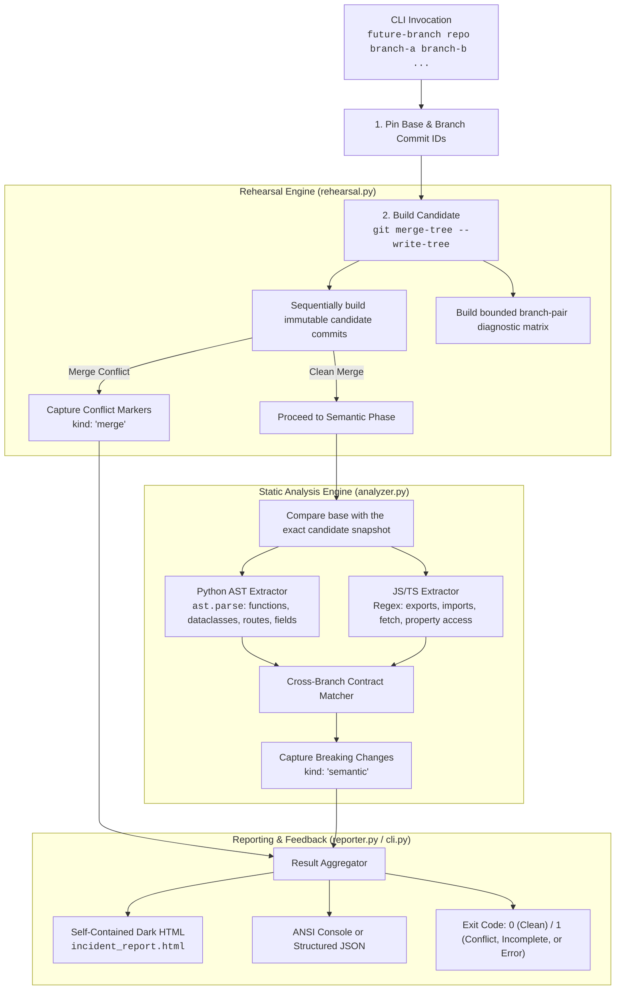

# Future Branch Architecture & Technical Design

Future Branch is a deterministic, offline pre-merge rehearsal gate designed for multi-branch development workflows — particularly where autonomous coding agents or human contributors work on parallel features that touch cross-module contracts.

---

## The Core Problem: Silent Contract Breaks

In traditional Git workflows, merges succeed cleanly whenever lines of code do not textually overlap in the exact same file region. However, in modern multi-tier applications:

```
[Agent A: Backend Branch]                    [Agent B: Frontend Branch]
Refactors user profile schema:               Builds billing widget:
  credits -> creditsbalance                     reads profile.credits
            │                                              │
            └───────────────┬──────────────────────────────┘
                            ▼
                   [Git Merge to main]
                  Textual Conflicts: 0
                  Build Status: Succeeded
                  Runtime Status: 💥 BROKEN (NaN / Undefined)
```

Both branches are **individually correct** in isolation, pass their own unit tests, and merge without conflict — yet the combined result is **collectively broken**.

---

## System Flow & Execution Pipeline



---

## Component Architecture

| Module | Role | Key Responsibilities |
|:---|:---|:---|
| `future_branch.cli` | User Entry Point | CLI parsing, path resolution, ANSI terminal formatting, exit code management. |
| `future_branch.rehearsal` | Git Candidate Engine | Pins commit IDs, builds sequential object trees, records merge conflicts, emits a capped pairwise diagnostic matrix, and returns immutable candidate identifiers. |
| `future_branch.analyzer` | Static Contract Analysis | Python AST traversal, JS/TS contract extraction, cross-branch schema & signature difference matching. |
| `future_branch.reporter` | Incident Visualizer | Standalone responsive dark-themed HTML report generation with evidence traces and suggested interventions. |

---

## Static Contract Extraction

### Python AST Parsing
The Python analyzer parses valid Python files into abstract syntax trees without executing code:
* **Functions (`ast.FunctionDef`, `ast.AsyncFunctionDef`)**: Reconstructs canonical signatures including positional args, keyword-only args, variadic `*args`/`**kwargs`, and return annotations.
* **Classes & Models (`ast.ClassDef`)**: Extracts type-annotated attributes (`ast.AnnAssign`) and standard assignments (`ast.Assign`).
* **Route Decorators (`@app.get`, `@app.post`, etc.)**: Extracts HTTP methods and endpoint paths.
* **Response Keys**: Extracts literal dictionary keys only from return expressions; unrelated strings are excluded.

### JavaScript / TypeScript Pattern Extraction
The JS analyzer scans source files for contract touchpoints:
* **Exports & Imports**: Tracks exported functions, classes, and imported modules.
* **API Invocations**: Identifies `fetch()` URL endpoints.
* **Consumed Fields**: Scans accessed response properties (e.g. `response.<field>`, `data.<field>`, `profile.<field>`).

---

## Extensibility: Adding New Analyzers

Future Branch is designed to be easily extensible. To add a new language or framework analyzer:

1. **Define contract extraction**: Add a parser function in `analyzer.py` (e.g. `_go_contracts(source: str)` or `_rust_contracts(source: str)`).
2. **Register file extensions**: In `BranchAnalyzer.semantic_conflicts()`, map file extensions (e.g. `.go`, `.rs`, `.java`) to your contract extractor.
3. **Add diff rules**: Implement matching logic comparing base contracts against branch changes.
4. **Add unit tests**: Add test cases in `tests/test_analyzer.py` validating extraction and conflict detection.

---

## Known Limitations

Future Branch is intentionally focused and offline. The current analyzer has specific boundaries:

1. **JavaScript/TypeScript parsing**: Uses regex matching rather than a full TypeScript compiler/AST. Complex destructuring patterns (`const { a, b: c } = await res.json()`) or type definitions are not yet fully introspected.
2. **Python Schema Frameworks**: Introspects standard dataclasses and class attributes; explicit Pydantic v2 `BaseModel` field validators, `TypedDict`, and SQLAlchemy column definitions are planned enhancements.
3. **Conflicted Candidates**: Rehearsal stops candidate construction at the first textual conflict. It preserves the conflict and marks merge-dependent semantic coverage incomplete instead of selecting a synthetic resolution.
4. **Dynamic Runtime Evaluation**: Contracts constructed entirely dynamically at runtime (e.g., dynamic `setattr` or dictionary unpacking) cannot be verified statically.
5. **Pairwise Scale**: The branch-pair matrix is diagnostic and capped at 500 merge checks. The explicitly ordered combined candidate remains the authoritative snapshot.
